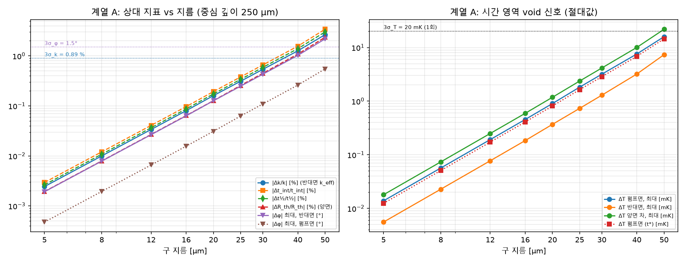
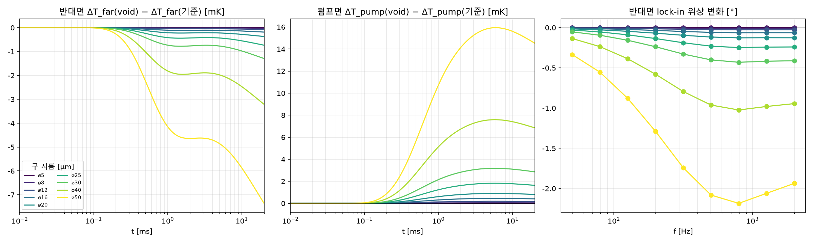
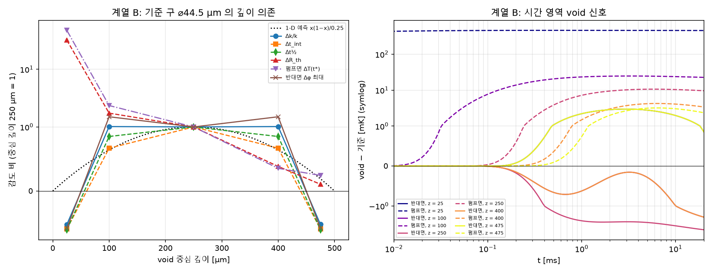
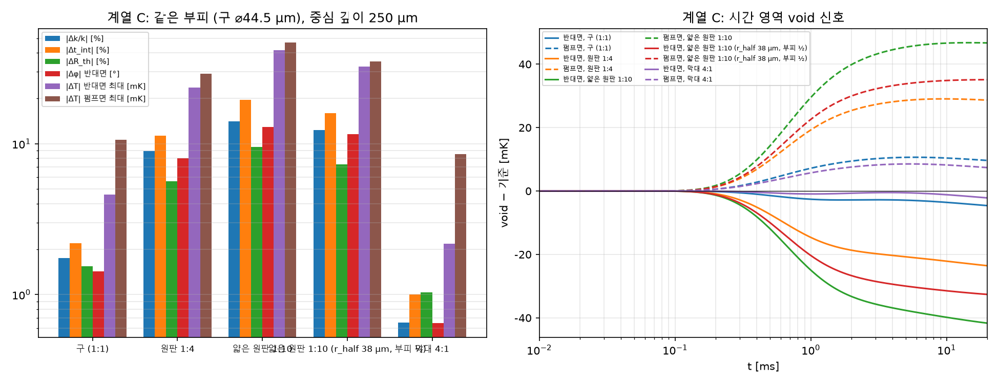

# CW 모드 void 검출 가능성 — 1단계 중간 보고 (2-D, 축 위 단일 void)

작성 2026-10-26. 스크립트 `studies/cw_void_detect.py`, 수치 `results/cw_void_detect/cases.csv`, 케이스별 `cases/<id>.json|.npz`. 계획: `docs/cw-void-detection-study-plan.md`.

## 0. 고정 조건

입사 10 mW, R = 0.6 (흡수 4.0 mW), 플랫 스팟 등가 반경 5.48 µm, 프로브 지름 8 µm 양면, L = 500 µm, R_cu = 40 µm, 외곽 far (자동 반경 561 µm, f_min 50 Hz), 관측창 20 ms, Δz 2.5 µm, Δt 성장률 1.05, Lock-in 50 Hz–2 kHz 로그 9점, t* = 20 ms, 스텝 절편 = 최대 기울기 접선, void 충전 k = 0.026 (공기). Lock-in 데이터 경로: 1/창(50 Hz) 미만은 주파수 영역 직접 풀이, 이상은 스텝 응답 FFT (9점 중 50 Hz 한 점만 직접). 모든 Δ 는 **같은 격자의 void 없는 via** 대비 (케이스마다 기준 via 를 같은 격자로 다시 계산).

## 1. 판정 기준 (가정은 가정)

| 지표 | 기준 | 가정 |
|---|---|---|
| k_eff | \|Δk/k\| ≥ 3 σ_k = 0.89 % (σ_k = 0.298 %: 기준 via 의 같은 경로 lock-in 위상에 σ_φ = 0.5° 가우시안 잡음, 400 회 역산) | σ_φ = 0.5° |
| Lock-in 위상 변화 | 기준 진폭이 잡음 바닥 σ_T = 6.7 mK 이상인 주파수 중 \|Δφ\| 가 최대인 주파수에서 \|Δφ\| ≥ 3 σ_φ = 1.5° | σ_φ = 0.5°; 진폭 바닥에 ΔT 잡음 준용 (반대면 2 kHz 는 3.4 mK 로 제외됨) |
| Lock-in 진폭 변화 | ≥ 3 × 흡수 편차 = 3 % | **흡수 편차 1 % 는 근거 없는 가정** (R 의존) |
| ΔT 변화 (펌프면·반대면·양면 차·R_th) | 신호 ≥ 3 σ_T = 20 mK (1회); N 회 평균 시 N = (3·6.7 mK / 신호)² | σ_T = 6.7 mK (ΔR/R 1e-6, c_tr 1.5e-4), R 의존 |
| t_int, t½ | \|Δt\| ≥ 3 σ_t, σ_t = σ_T / (반대면 곡선 최대 기울기) = 34.6 µs | 동일; t½ 는 미분 곡선이므로 실제 시각 잡음은 이보다 크다 (하한) |

ΔT 류 신호의 '최대' 는 관측창 안에서 \|void − 기준\| 이 가장 큰 시각의 값, 괄호의 상대 변화는 기준 신호가 σ_T 이상인 구간에서의 최대값.

## 2. 기준 via (void 없음)

| 경로 | k_eff [W/mK] | σ_k(σ_φ = 0.5°) [%] |
|---|---|---|
| 혼합 (1/창 미만 직접, 이상 스텝 FFT) — 사용 | 402.7 (+1.19 %) | 0.298 |
| 주파수 영역 직접 풀이 | 402.9 (+1.22 %) | 0.298 |
| 스텝 FFT 전체 | 402.5 (+1.14 %) | 0.298 |

ΔT_pump(t*) = 2.191 K, ΔT_far(t*) = 1.262 K, t_int = 0.277 ms, t½ = 0.252 ms, R_th(t*) = 232 K/W, 반대면 최대 기울기 194 K/s. 반대면 lock-in 진폭 320 mK @ 50 Hz → 3.4 mK @ 2 kHz; 펌프면 789 → 350 mK. 참값 k = 398 W/mK (유리 껍질 TLM 모델 편향 +1 %).

## 3. 계열 A — 크기 사다리 (구, 축 위, 중심 깊이 250 µm)

계획의 사다리(5–40 µm)에서는 목표 \|Δk/k\| = 1.79 % 에 못 미쳐 50 µm 를 추가했다.

| 지름 [µm] | k_eff (반대면) | 위상 변화, 반대면 | 진폭 변화, 반대면 | t_int (반대면) | t½ (반대면) | ΔT 반대면 (최대) | 위상 변화, 펌프면 | 진폭 변화, 펌프면 | ΔT 펌프면 (최대) | ΔT 펌프면 (t*) | R_th(t*) (양면) | ΔT 양면 차 (최대) |
|---|---|---|---|---|---|---|---|---|---|---|---|---|
| 5 | -0.00 % | -0.00° @ 795 Hz (20.0 mK) | -0.01 % @ 2000 Hz | +0.0 µs (+0.00 %) | +0.0 µs (+0.00 %) | -0.01 mK @ 20.00 ms (-0.01 % @ 0.25 ms) | -0.00° @ 316 Hz (478.3 mK) | +0.00 % @ 79 Hz | +0.01 mK @ 5.63 ms (+0.00 % @ 1.94 ms) | +0.01 mK (+0.00 %) | +0.00 % (+0.02 mK) | +0.02 mK @ 20.00 ms (+0.00 % @ 20.00 ms) |
| 8 | -0.01 % | -0.01° @ 795 Hz (20.0 mK) | -0.02 % @ 2000 Hz | +0.0 µs (+0.01 %) | +0.0 µs (+0.01 %) | -0.02 mK @ 20.00 ms (-0.03 % @ 0.25 ms) | -0.00° @ 316 Hz (478.5 mK) | +0.01 % @ 79 Hz | +0.06 mK @ 5.63 ms (+0.00 % @ 1.94 ms) | +0.05 mK (+0.00 %) | +0.01 % (+0.07 mK) | +0.07 mK @ 20.00 ms (+0.01 % @ 20.00 ms) |
| 12 | -0.03 % | -0.03° @ 795 Hz (20.0 mK) | -0.08 % @ 2000 Hz | +0.1 µs (+0.04 %) | +0.1 µs (+0.04 %) | -0.08 mK @ 20.00 ms (-0.09 % @ 0.25 ms) | -0.01° @ 316 Hz (477.9 mK) | +0.02 % @ 79 Hz | +0.19 mK @ 5.63 ms (+0.01 % @ 1.94 ms) | +0.17 mK (+0.01 %) | +0.03 % (+0.25 mK) | +0.25 mK @ 20.00 ms (+0.03 % @ 20.00 ms) |
| 16 | -0.08 % | -0.06° @ 795 Hz (20.0 mK) | -0.18 % @ 2000 Hz | +0.3 µs (+0.10 %) | +0.2 µs (+0.09 %) | -0.18 mK @ 20.00 ms (-0.22 % @ 0.25 ms) | -0.02° @ 316 Hz (477.2 mK) | +0.04 % @ 79 Hz | +0.46 mK @ 5.63 ms (+0.03 % @ 1.94 ms) | +0.41 mK (+0.02 %) | +0.06 % (+0.59 mK) | +0.59 mK @ 20.00 ms (+0.06 % @ 20.00 ms) |
| 20 | -0.16 % | -0.13° @ 795 Hz (20.0 mK) | -0.36 % @ 2000 Hz | +0.5 µs (+0.19 %) | +0.4 µs (+0.17 %) | -0.37 mK @ 20.00 ms (-0.44 % @ 0.25 ms) | -0.03° @ 316 Hz (478.4 mK) | +0.08 % @ 79 Hz | +0.90 mK @ 5.63 ms (+0.07 % @ 1.94 ms) | +0.81 mK (+0.04 %) | +0.13 % (+1.18 mK) | +1.18 mK @ 20.00 ms (+0.13 % @ 20.00 ms) |
| 25 | -0.31 % | -0.25° @ 795 Hz (20.0 mK) | -0.71 % @ 2000 Hz | +1.1 µs (+0.38 %) | +0.9 µs (+0.34 %) | -0.73 mK @ 20.00 ms (-0.85 % @ 0.25 ms) | -0.06° @ 316 Hz (477.6 mK) | +0.16 % @ 79 Hz | +1.82 mK @ 5.63 ms (+0.13 % @ 1.94 ms) | +1.64 mK (+0.07 %) | +0.26 % (+2.37 mK) | +2.37 mK @ 20.00 ms (+0.26 % @ 20.00 ms) |
| 30 | -0.54 % | -0.43° @ 795 Hz (20.0 mK) | -1.25 % @ 2000 Hz | +1.8 µs (+0.66 %) | +1.5 µs (+0.59 %) | -1.29 mK @ 20.00 ms (-1.47 % @ 0.25 ms) | -0.11° @ 316 Hz (478.2 mK) | +0.28 % @ 79 Hz | +3.18 mK @ 5.63 ms (+0.23 % @ 1.94 ms) | +2.86 mK (+0.13 %) | +0.45 % (+4.15 mK) | +4.15 mK @ 20.00 ms (+0.45 % @ 20.00 ms) |
| 40 | -1.26 % | -1.02° @ 795 Hz (20.0 mK) | -3.05 % @ 2000 Hz | +4.4 µs (+1.57 %) | +3.5 µs (+1.40 %) | -3.21 mK @ 20.00 ms (-3.47 % @ 0.25 ms) | -0.26° @ 316 Hz (478.3 mK) | +0.67 % @ 79 Hz | +7.59 mK @ 5.95 ms (+0.55 % @ 1.94 ms) | +6.85 mK (+0.31 %) | +1.08 % (+10.06 mK) | +10.06 mK @ 20.00 ms (+1.08 % @ 20.00 ms) |
| 50 | -2.65 % | -2.18° @ 795 Hz (20.0 mK) | -6.74 % @ 2000 Hz | +9.5 µs (+3.41 %) | +7.6 µs (+3.01 %) | -7.36 mK @ 20.00 ms (-7.39 % @ 0.25 ms) | -0.55° @ 316 Hz (478.5 mK) | +1.40 % @ 79 Hz | +15.94 mK @ 5.95 ms (+1.16 % @ 1.94 ms) | +14.53 mK (+0.66 %) | +2.36 % (+21.89 mK) | +21.89 mK @ 20.00 ms (+2.36 % @ 20.00 ms) |

판정 (가능/불가) 과 검출에 필요한 조건 (k_eff·위상: 필요한 σ_φ; 진폭: 허용 흡수 편차; ΔT 류: 필요한 평균 횟수 N):

| 지름 [µm] | k_eff (반대면) | 위상 변화, 반대면 | 진폭 변화, 반대면 | t_int (반대면) | t½ (반대면) | ΔT 반대면 (최대) | 위상 변화, 펌프면 | 진폭 변화, 펌프면 | ΔT 펌프면 (최대) | ΔT 펌프면 (t*) | R_th(t*) (양면) | ΔT 양면 차 (최대) |
|---|---|---|---|---|---|---|---|---|---|---|---|---|
| 5 | 불가 (σ_φ ≤ 0.00°) | 불가 (σ_φ ≤ 0.00°) | 불가 (흡수 편차 ≤ 0.00 %) | 불가 (N ≥ 2e+08) | 불가 (N ≥ 2e+08) | 불가 (N ≥ 1e+07) | 불가 (σ_φ ≤ 0.00°) | 불가 (흡수 편차 ≤ 0.00 %) | 불가 (N ≥ 2e+06) | 불가 (N ≥ 3e+06) | 불가 (N ≥ 1e+06) | 불가 (N ≥ 1e+06) |
| 8 | 불가 (σ_φ ≤ 0.01°) | 불가 (σ_φ ≤ 0.00°) | 불가 (흡수 편차 ≤ 0.01 %) | 불가 (N ≥ 1e+07) | 불가 (N ≥ 1e+07) | 불가 (N ≥ 8e+05) | 불가 (σ_φ ≤ 0.00°) | 불가 (흡수 편차 ≤ 0.00 %) | 불가 (N ≥ 1e+05) | 불가 (N ≥ 2e+05) | 불가 (N ≥ 7e+04) | 불가 (N ≥ 7e+04) |
| 12 | 불가 (σ_φ ≤ 0.02°) | 불가 (σ_φ ≤ 0.01°) | 불가 (흡수 편차 ≤ 0.03 %) | 불가 (N ≥ 8e+05) | 불가 (N ≥ 1e+06) | 불가 (N ≥ 7e+04) | 불가 (σ_φ ≤ 0.00°) | 불가 (흡수 편차 ≤ 0.01 %) | 불가 (N ≥ 1e+04) | 불가 (N ≥ 1e+04) | 불가 (N ≥ 6490) | 불가 (N ≥ 6490) |
| 16 | 불가 (σ_φ ≤ 0.04°) | 불가 (σ_φ ≤ 0.02°) | 불가 (흡수 편차 ≤ 0.06 %) | 불가 (N ≥ 1e+05) | 불가 (N ≥ 2e+05) | 불가 (N ≥ 1e+04) | 불가 (σ_φ ≤ 0.01°) | 불가 (흡수 편차 ≤ 0.01 %) | 불가 (N ≥ 1945) | 불가 (N ≥ 2411) | 불가 (N ≥ 1147) | 불가 (N ≥ 1147) |
| 20 | 불가 (σ_φ ≤ 0.09°) | 불가 (σ_φ ≤ 0.04°) | 불가 (흡수 편차 ≤ 0.12 %) | 불가 (N ≥ 4e+04) | 불가 (N ≥ 6e+04) | 불가 (N ≥ 2964) | 불가 (σ_φ ≤ 0.01°) | 불가 (흡수 편차 ≤ 0.03 %) | 불가 (N ≥ 497) | 불가 (N ≥ 614) | 불가 (N ≥ 290) | 불가 (N ≥ 290) |
| 25 | 불가 (σ_φ ≤ 0.17°) | 불가 (σ_φ ≤ 0.08°) | 불가 (흡수 편차 ≤ 0.24 %) | 불가 (N ≥ 9683) | 불가 (N ≥ 1e+04) | 불가 (N ≥ 752) | 불가 (σ_φ ≤ 0.02°) | 불가 (흡수 편차 ≤ 0.05 %) | 불가 (N ≥ 122) | 불가 (N ≥ 151) | 불가 (N ≥ 72) | 불가 (N ≥ 72) |
| 30 | 불가 (σ_φ ≤ 0.30°) | 불가 (σ_φ ≤ 0.14°) | 불가 (흡수 편차 ≤ 0.42 %) | 불가 (N ≥ 3208) | 불가 (N ≥ 4865) | 불가 (N ≥ 242) | 불가 (σ_φ ≤ 0.04°) | 불가 (흡수 편차 ≤ 0.09 %) | 불가 (N ≥ 40) | 불가 (N ≥ 50) | 불가 (N ≥ 24) | 불가 (N ≥ 24) |
| 40 | 가능 (σ_φ ≤ 0.71°) | 불가 (σ_φ ≤ 0.34°) | 가능 (흡수 편차 ≤ 1.02 %) | 불가 (N ≥ 568) | 불가 (N ≥ 864) | 불가 (N ≥ 40) | 불가 (σ_φ ≤ 0.09°) | 불가 (흡수 편차 ≤ 0.22 %) | 불가 (N ≥ 8) | 불가 (N ≥ 9) | 불가 (N ≥ 4) | 불가 (N ≥ 4) |
| 50 | 가능 (σ_φ ≤ 1.48°) | 가능 (σ_φ ≤ 0.73°) | 가능 (흡수 편차 ≤ 2.25 %) | 불가 (N ≥ 120) | 불가 (N ≥ 186) | 불가 (N ≥ 8) | 불가 (σ_φ ≤ 0.18°) | 불가 (흡수 편차 ≤ 0.47 %) | 불가 (N ≥ 2) | 불가 (N ≥ 2) | 가능 (N ≥ 1) | 가능 (N ≥ 1) |

## 4. 기준 void 선정

기준: Δk/k ≈ 2 × 3σ_k = 1.79 %. 40 µm (1.26 %) 과 50 µm (2.65 %) 사이 log-log 보간 → 44.4 µm, 0.5 µm 로 반올림. → **기준 void = 구 ⌀44.5 µm** (부피 46140 µm³, 단면 점유 31 %, 실제 Δk/k = -1.74 %).
사다리의 \|Δk/k\| 는 지름의 약 3.3 제곱에 비례한다 (보간 구간).

## 5. 계열 B — 깊이 (기준 구)

| 중심 깊이 [µm] | k_eff (반대면) | 위상 변화, 반대면 | 진폭 변화, 반대면 | t_int (반대면) | t½ (반대면) | ΔT 반대면 (최대) | 위상 변화, 펌프면 | 진폭 변화, 펌프면 | ΔT 펌프면 (최대) | ΔT 펌프면 (t*) | R_th(t*) (양면) | ΔT 양면 차 (최대) |
|---|---|---|---|---|---|---|---|---|---|---|---|---|
| 25 | +0.91 % | +0.83° @ 795 Hz (20.0 mK) | +4.23 % @ 2000 Hz | -3.6 µs (-1.30 %) | -3.0 µs (-1.18 %) | +2.97 mK @ 3.01 ms (+2.79 % @ 0.30 ms) | +8.06° @ 126 Hz (543.7 mK) | +93.31 % @ 2000 Hz | +461.68 mK @ 0.43 ms (+80.66 % @ 0.00 ms) | +456.90 mK (+20.69 %) | +48.16 % (+456.04 mK) | +461.18 mK @ 0.29 ms (+80.66 % @ 0.00 ms) |
| 100 | -1.77 % | -1.63° @ 1261 Hz (8.9 mK) | -2.06 % @ 2000 Hz | +4.1 µs (+1.46 %) | +4.2 µs (+1.66 %) | -2.05 mK @ 20.00 ms (-3.70 % @ 0.25 ms) | -0.91° @ 1261 Hz (374.1 mK) | +2.74 % @ 199 Hz | +24.74 mK @ 3.30 ms (+2.32 % @ 0.63 ms) | +22.68 mK (+1.04 %) | +2.67 % (+24.73 mK) | +24.90 mK @ 3.59 ms (+2.72 % @ 2.04 ms) |
| 250 | -1.74 % | -1.43° @ 795 Hz (20.0 mK) | -4.32 % @ 2000 Hz | +6.1 µs (+2.18 %) | +4.9 µs (+1.94 %) | -4.61 mK @ 20.00 ms (-4.82 % @ 0.25 ms) | -0.37° @ 316 Hz (478.2 mK) | +0.94 % @ 79 Hz | +10.65 mK @ 5.95 ms (+0.78 % @ 1.94 ms) | +9.64 mK (+0.44 %) | +1.54 % (+14.24 mK) | +14.24 mK @ 20.00 ms (+1.54 % @ 20.00 ms) |
| 400 | -1.77 % | -1.63° @ 1261 Hz (8.9 mK) | -2.06 % @ 2000 Hz | +4.1 µs (+1.46 %) | +4.2 µs (+1.66 %) | -2.05 mK @ 20.00 ms (-3.70 % @ 0.25 ms) | -0.14° @ 199 Hz (523.2 mK) | +0.34 % @ 50 Hz | +4.26 mK @ 6.26 ms (+0.28 % @ 3.59 ms) | +3.41 mK (+0.16 %) | +0.59 % (+5.46 mK) | +5.46 mK @ 20.00 ms (+0.59 % @ 20.00 ms) |
| 475 | +0.91 % | +0.83° @ 795 Hz (20.0 mK) | +4.25 % @ 2000 Hz | -3.6 µs (-1.30 %) | -3.0 µs (-1.18 %) | +2.97 mK @ 3.01 ms (+2.78 % @ 0.30 ms) | -0.11° @ 126 Hz (582.8 mK) | +0.26 % @ 50 Hz | +3.20 mK @ 6.26 ms (+0.21 % @ 4.24 ms) | +2.35 mK (+0.11 %) | +0.16 % (+1.50 mK) | +1.50 mK @ 20.00 ms (-0.17 % @ 0.93 ms) |

판정 (가능/불가) 과 검출에 필요한 조건 (k_eff·위상: 필요한 σ_φ; 진폭: 허용 흡수 편차; ΔT 류: 필요한 평균 횟수 N):

| 중심 깊이 [µm] | k_eff (반대면) | 위상 변화, 반대면 | 진폭 변화, 반대면 | t_int (반대면) | t½ (반대면) | ΔT 반대면 (최대) | 위상 변화, 펌프면 | 진폭 변화, 펌프면 | ΔT 펌프면 (최대) | ΔT 펌프면 (t*) | R_th(t*) (양면) | ΔT 양면 차 (최대) |
|---|---|---|---|---|---|---|---|---|---|---|---|---|
| 25 | 가능 (σ_φ ≤ 0.51°) | 불가 (σ_φ ≤ 0.28°) | 가능 (흡수 편차 ≤ 1.41 %) | 불가 (N ≥ 823) | 불가 (N ≥ 1215) | 불가 (N ≥ 46) | 가능 (σ_φ ≤ 2.69°) | 가능 (흡수 편차 ≤ 31.10 %) | 가능 (N ≥ 1) | 가능 (N ≥ 1) | 가능 (N ≥ 1) | 가능 (N ≥ 1) |
| 100 | 가능 (σ_φ ≤ 0.99°) | 가능 (σ_φ ≤ 0.54°) | 불가 (흡수 편차 ≤ 0.69 %) | 불가 (N ≥ 653) | 불가 (N ≥ 614) | 불가 (N ≥ 96) | 불가 (σ_φ ≤ 0.30°) | 불가 (흡수 편차 ≤ 0.91 %) | 가능 (N ≥ 1) | 가능 (N ≥ 1) | 가능 (N ≥ 1) | 가능 (N ≥ 1) |
| 250 | 가능 (σ_φ ≤ 0.98°) | 불가 (σ_φ ≤ 0.48°) | 가능 (흡수 편차 ≤ 1.44 %) | 불가 (N ≥ 292) | 불가 (N ≥ 445) | 불가 (N ≥ 20) | 불가 (σ_φ ≤ 0.12°) | 불가 (흡수 편차 ≤ 0.31 %) | 불가 (N ≥ 4) | 불가 (N ≥ 5) | 불가 (N ≥ 2) | 불가 (N ≥ 2) |
| 400 | 가능 (σ_φ ≤ 0.99°) | 가능 (σ_φ ≤ 0.54°) | 불가 (흡수 편차 ≤ 0.69 %) | 불가 (N ≥ 653) | 불가 (N ≥ 614) | 불가 (N ≥ 96) | 불가 (σ_φ ≤ 0.05°) | 불가 (흡수 편차 ≤ 0.11 %) | 불가 (N ≥ 23) | 불가 (N ≥ 35) | 불가 (N ≥ 14) | 불가 (N ≥ 14) |
| 475 | 가능 (σ_φ ≤ 0.51°) | 불가 (σ_φ ≤ 0.28°) | 가능 (흡수 편차 ≤ 1.42 %) | 불가 (N ≥ 823) | 불가 (N ≥ 1216) | 불가 (N ≥ 46) | 불가 (σ_φ ≤ 0.04°) | 불가 (흡수 편차 ≤ 0.09 %) | 불가 (N ≥ 40) | 불가 (N ≥ 73) | 불가 (N ≥ 180) | 불가 (N ≥ 180) |

감도의 깊이 의존 (중심 깊이 250 µm 값으로 정규화; t_int 의 1-D 근사 예측은 ∝ x(1−x), x = z/L):

| 중심 깊이 [µm] | x(1−x)/0.25 (예측) | Δt_int 비 | Δt½ 비 | ΔR_th 비 | Δk/k 비 | 반대면 Δφ 최대 비 | 펌프면 ΔT(t*) 비 | 반대면 ΔT 최대 비 |
|---|---|---|---|---|---|---|---|---|
| 25 | 0.19 | -0.60 | -0.61 | 32.02 | -0.52 | -0.58 | 47.41 | -0.64 |
| 100 | 0.64 | 0.67 | 0.85 | 1.74 | 1.02 | 1.50 | 2.35 | 0.45 |
| 250 | 1.00 | 1.00 | 1.00 | 1.00 | 1.00 | 1.00 | 1.00 | 1.00 |
| 400 | 0.64 | 0.67 | 0.85 | 0.38 | 1.02 | 1.50 | 0.35 | 0.45 |
| 475 | 0.19 | -0.60 | -0.60 | 0.11 | -0.52 | -0.58 | 0.24 | -0.65 |

## 6. 계열 C — 형태 (기준 부피 동일, 중심 깊이 250 µm)

| 형태 | r_half [µm] | 두께 [µm] | 단면 점유 [%] | 비고 |
|---|---|---|---|---|
| 구 (1:1) | 22.2 | 44.5 | 31 | — |
| 원판 1:4 | 35.3 | 17.7 | 78 | — |
| 얇은 원판 1:10 | 38.0 | 15.3 | 90 | r_half 가 R_cu 를 넘어 r_half = 38 µm 로 제한, 같은 부피 → 실제 축비 1:5.0 |
| 얇은 원판 1:10 (r_half 38 µm, 부피 ½) | 38.0 | 7.6 | 90 | 부피 50 % (기준 부피의) |
| 막대 4:1 | 14.0 | 112.1 | 12 | — |

| 형태 | k_eff (반대면) | 위상 변화, 반대면 | 진폭 변화, 반대면 | t_int (반대면) | t½ (반대면) | ΔT 반대면 (최대) | 위상 변화, 펌프면 | 진폭 변화, 펌프면 | ΔT 펌프면 (최대) | ΔT 펌프면 (t*) | R_th(t*) (양면) | ΔT 양면 차 (최대) |
|---|---|---|---|---|---|---|---|---|---|---|---|---|
| 구 (1:1) | -1.74 % | -1.43° @ 795 Hz (20.0 mK) | -4.32 % @ 2000 Hz | +6.1 µs (+2.18 %) | +4.9 µs (+1.94 %) | -4.61 mK @ 20.00 ms (-4.82 % @ 0.25 ms) | -0.37° @ 316 Hz (478.2 mK) | +0.94 % @ 79 Hz | +10.65 mK @ 5.95 ms (+0.78 % @ 1.94 ms) | +9.64 mK (+0.44 %) | +1.54 % (+14.24 mK) | +14.24 mK @ 20.00 ms (+1.54 % @ 20.00 ms) |
| 원판 1:4 | -8.97 % | -7.46° @ 1261 Hz (8.9 mK) | -20.51 % @ 2000 Hz | +31.6 µs (+11.34 %) | +26.6 µs (+10.51 %) | -23.56 mK @ 20.00 ms (-24.37 % @ 0.25 ms) | -1.03° @ 316 Hz (478.5 mK) | +2.48 % @ 79 Hz | +29.06 mK @ 9.25 ms (+2.09 % @ 1.84 ms) | +28.67 mK (+1.31 %) | +5.63 % (+52.23 mK) | +52.23 mK @ 20.00 ms (+5.63 % @ 20.00 ms) |
| 얇은 원판 1:10 | -14.06 % | -12.03° @ 1261 Hz (8.9 mK) | -32.51 % @ 2000 Hz | +54.5 µs (+19.53 %) | +45.6 µs (+17.98 %) | -41.68 mK @ 20.00 ms (-37.48 % @ 0.25 ms) | -1.63° @ 316 Hz (478.5 mK) | +3.89 % @ 79 Hz | +46.78 mK @ 14.36 ms (+3.28 % @ 1.94 ms) | +46.71 mK (+2.13 %) | +9.52 % (+88.39 mK) | +88.39 mK @ 20.00 ms (+9.52 % @ 20.00 ms) |
| 얇은 원판 1:10 (r_half 38 µm, 부피 ½) | -12.28 % | -10.51° @ 1261 Hz (8.9 mK) | -27.24 % @ 2000 Hz | +44.4 µs (+15.93 %) | +37.6 µs (+14.85 %) | -32.61 mK @ 20.00 ms (-32.70 % @ 0.25 ms) | -1.23° @ 316 Hz (478.5 mK) | +2.91 % @ 79 Hz | +35.11 mK @ 20.00 ms (+2.47 % @ 1.94 ms) | +35.11 mK (+1.60 %) | +7.30 % (+67.73 mK) | +67.73 mK @ 20.00 ms (+7.30 % @ 20.00 ms) |
| 막대 4:1 | -0.65 % | -0.65° @ 501 Hz (38.9 mK) | -1.92 % @ 2000 Hz | +2.8 µs (+1.00 %) | +2.1 µs (+0.83 %) | -2.17 mK @ 20.00 ms (-1.74 % @ 0.25 ms) | -0.28° @ 316 Hz (478.4 mK) | +0.76 % @ 79 Hz | +8.54 mK @ 5.31 ms (+0.62 % @ 2.04 ms) | +7.39 mK (+0.34 %) | +1.03 % (+9.55 mK) | +9.55 mK @ 20.00 ms (+1.03 % @ 20.00 ms) |

판정 (가능/불가) 과 검출에 필요한 조건 (k_eff·위상: 필요한 σ_φ; 진폭: 허용 흡수 편차; ΔT 류: 필요한 평균 횟수 N):

| 형태 | k_eff (반대면) | 위상 변화, 반대면 | 진폭 변화, 반대면 | t_int (반대면) | t½ (반대면) | ΔT 반대면 (최대) | 위상 변화, 펌프면 | 진폭 변화, 펌프면 | ΔT 펌프면 (최대) | ΔT 펌프면 (t*) | R_th(t*) (양면) | ΔT 양면 차 (최대) |
|---|---|---|---|---|---|---|---|---|---|---|---|---|
| 구 (1:1) | 가능 (σ_φ ≤ 0.98°) | 불가 (σ_φ ≤ 0.48°) | 가능 (흡수 편차 ≤ 1.44 %) | 불가 (N ≥ 292) | 불가 (N ≥ 445) | 불가 (N ≥ 20) | 불가 (σ_φ ≤ 0.12°) | 불가 (흡수 편차 ≤ 0.31 %) | 불가 (N ≥ 4) | 불가 (N ≥ 5) | 불가 (N ≥ 2) | 불가 (N ≥ 2) |
| 원판 1:4 | 가능 (σ_φ ≤ 5.01°) | 가능 (σ_φ ≤ 2.49°) | 가능 (흡수 편차 ≤ 6.84 %) | 불가 (N ≥ 11) | 불가 (N ≥ 16) | 가능 (N ≥ 1) | 불가 (σ_φ ≤ 0.34°) | 불가 (흡수 편차 ≤ 0.83 %) | 가능 (N ≥ 1) | 가능 (N ≥ 1) | 가능 (N ≥ 1) | 가능 (N ≥ 1) |
| 얇은 원판 1:10 | 가능 (σ_φ ≤ 7.85°) | 가능 (σ_φ ≤ 4.01°) | 가능 (흡수 편차 ≤ 10.84 %) | 불가 (N ≥ 4) | 불가 (N ≥ 6) | 가능 (N ≥ 1) | 가능 (σ_φ ≤ 0.54°) | 가능 (흡수 편차 ≤ 1.30 %) | 가능 (N ≥ 1) | 가능 (N ≥ 1) | 가능 (N ≥ 1) | 가능 (N ≥ 1) |
| 얇은 원판 1:10 (r_half 38 µm, 부피 ½) | 가능 (σ_φ ≤ 6.86°) | 가능 (σ_φ ≤ 3.50°) | 가능 (흡수 편차 ≤ 9.08 %) | 불가 (N ≥ 6) | 불가 (N ≥ 8) | 가능 (N ≥ 1) | 불가 (σ_φ ≤ 0.41°) | 불가 (흡수 편차 ≤ 0.97 %) | 가능 (N ≥ 1) | 가능 (N ≥ 1) | 가능 (N ≥ 1) | 가능 (N ≥ 1) |
| 막대 4:1 | 불가 (σ_φ ≤ 0.36°) | 불가 (σ_φ ≤ 0.22°) | 불가 (흡수 편차 ≤ 0.64 %) | 불가 (N ≥ 1379) | 불가 (N ≥ 2468) | 불가 (N ≥ 86) | 불가 (σ_φ ≤ 0.09°) | 불가 (흡수 편차 ≤ 0.25 %) | 불가 (N ≥ 6) | 불가 (N ≥ 8) | 불가 (N ≥ 5) | 불가 (N ≥ 5) |

## 7. 요약 — 프로브 구성 × 지표별 검출 한계 (축 위 단일 void, 이 단계의 범위)

| 프로브 구성 | 지표 | 축 위 구: 검출 최소 지름 [µm] (사다리) | 기준 구의 검출 깊이 [µm] | 기준 부피에서 검출되는 형태 |
|---|---|---|---|---|
| 반대면 | k_eff (반대면) | ≥ 40 | 25, 100, 250, 400, 475 | 구 (1:1), 원판 1:4, 얇은 원판 1:10, 얇은 원판 1:10 (r_half 38 µm, 부피 ½) |
| 반대면 | 위상 변화, 반대면 | ≥ 50 | 100, 400 | 원판 1:4, 얇은 원판 1:10, 얇은 원판 1:10 (r_half 38 µm, 부피 ½) |
| 반대면 | 진폭 변화, 반대면 | ≥ 40 | 25, 250, 475 | 구 (1:1), 원판 1:4, 얇은 원판 1:10, 얇은 원판 1:10 (r_half 38 µm, 부피 ½) |
| 반대면 | t_int (반대면) | 불가 (사다리 내) | 불가 | 없음 |
| 반대면 | t½ (반대면) | 불가 (사다리 내) | 불가 | 없음 |
| 반대면 | ΔT 반대면 (최대) | 불가 (사다리 내) | 불가 | 원판 1:4, 얇은 원판 1:10, 얇은 원판 1:10 (r_half 38 µm, 부피 ½) |
| 펌프면 | 위상 변화, 펌프면 | 불가 (사다리 내) | 25 | 얇은 원판 1:10 |
| 펌프면 | 진폭 변화, 펌프면 | 불가 (사다리 내) | 25 | 얇은 원판 1:10 |
| 펌프면 | ΔT 펌프면 (최대) | 불가 (사다리 내) | 25, 100 | 원판 1:4, 얇은 원판 1:10, 얇은 원판 1:10 (r_half 38 µm, 부피 ½) |
| 펌프면 | ΔT 펌프면 (t*) | 불가 (사다리 내) | 25, 100 | 원판 1:4, 얇은 원판 1:10, 얇은 원판 1:10 (r_half 38 µm, 부피 ½) |
| 양면 | R_th(t*) (양면) | ≥ 50 | 25, 100 | 원판 1:4, 얇은 원판 1:10, 얇은 원판 1:10 (r_half 38 µm, 부피 ½) |
| 양면 | ΔT 양면 차 (최대) | ≥ 50 | 25, 100 | 원판 1:4, 얇은 원판 1:10, 얇은 원판 1:10 (r_half 38 µm, 부피 ½) |

핵심:

* **가장 유리한 구성·지표는 반대면 프로브의 k_eff (위상 TLM)** 다: 축 위 구는 지름 40 µm 부터, 기준 구(⌀44.5 µm)는 모든 깊이에서 3σ_k 를 넘는다. 같은 반대면 데이터의 개별 위상 변화(최대 1–2°)는 3σ_φ = 1.5° 경계에 걸리고, 진폭 변화는 흡수 편차 가정에 좌우된다.
* 구형 void 의 k_eff 신호는 작다: \|Δk/k\| ∝ d^3.3, ⌀25 µm 에서 0.3 %, ⌀50 µm 에서 2.7 %. 이유는 부록 8.3: void 는 열이 채우지 못하는 부피이므로 열용량을 빼고(겉보기 α 상승, 로드 중앙 +1.8 %), 직렬 저항은 이를 넘어서는 만큼만(−3.5 %) 보인다. 면 근처(25·475 µm)에서는 열류가 어차피 스팟에서 퍼지는 중이라 축 위 장애물의 저항이 작고 열용량 효과는 더 커서(+3.3 %) Δk/k 부호가 뒤집힌다 (+0.91 %).
* 반대면 지표(k_eff, t_int, t½, 반대면 ΔT·위상)는 z 와 L−z 에 대해 정확히 대칭이다 (100 ↔ 400, 25 ↔ 475): 반대면 프로브는 void 깊이를 구분하지 못한다. t_int 의 깊이 의존은 100–400 µm 구간에서 1-D 예측 x(1−x) 와 맞고(0.67 vs 0.64), 양 끝에서는 열용량 효과로 부호가 바뀐다.
* 펌프면·양면 지표는 펌프면 쪽 void 에만 강하다: 중심 깊이 25 µm 의 기준 구는 펌프면 ΔT +0.46 K (1회 측정으로 충분), 100 µm 에서 +25 mK (1회), 250 µm 부터는 평균이 필요하다. R_th 의 깊이 의존은 flux ∝ 1 − z/L 예측대로 선형에 가깝다 (100: 1.7, 400: 0.38).
* 형태: 같은 부피면 **넓은 원판이 구보다 5–8배** 큰 신호를 낸다 (1:4 원판 Δk/k −9 %, 반대면 ΔT −24 mK 로 1회 검출). 막대(4:1)는 구의 1/3 로 k_eff 로도 못 본다. 등가 1:10 원판은 R_cu 안에 들어가지 않으므로(r_half 48 µm) r_half 38 µm 로 제한한 두 변형(같은 부피 → 1:5 / 진짜 1:10 → 부피 절반)을 돌렸다: 단면 점유(90 %)가 같으면 두께가 절반이어도 Δk/k 는 −12 % 대 −14 % 로 비슷하다 — 신호는 부피보다 **막힌 단면적**이 정한다.
* 시간 영역 반대면 신호(void − 기준)는 20 ms 끝에서 최대이고 포화하지 않는다: 창을 늘리면 더 커진다 (DC 극한에서 void 의 직렬 저항 × 통과 열류). 펌프면 신호는 5–6 ms 에서 최대 후 줄어든다.

## 8. 부록

### 8.1 계산 경로 교차검증 (Δk/k [%]: 혼합 경로 vs 직접 풀이 vs 스텝 FFT)

| 케이스 | 혼합 | 직접 | 스텝 FFT | 기준 k (혼합/직접/FFT) |
|---|---|---|---|---|
| A_sph_d5_z250 | -0.002 | -0.002 | -0.002 | 402.3 / 402.4 / 402.1 |
| A_sph_d8_z250 | -0.010 | -0.010 | -0.010 | 402.3 / 402.4 / 402.1 |
| A_sph_d12_z250 | -0.034 | -0.034 | -0.034 | 402.3 / 402.4 / 402.1 |
| A_sph_d16_z250 | -0.080 | -0.080 | -0.080 | 401.9 / 402.0 / 401.7 |
| A_sph_d20_z250 | -0.160 | -0.160 | -0.160 | 401.5 / 401.6 / 401.3 |
| A_sph_d25_z250 | -0.311 | -0.311 | -0.311 | 401.5 / 401.6 / 401.3 |
| A_sph_d30_z250 | -0.538 | -0.537 | -0.538 | 401.2 / 401.3 / 401.0 |
| A_sph_d40_z250 | -1.262 | -1.261 | -1.262 | 400.8 / 400.9 / 400.6 |
| A_sph_d50_z250 | -2.652 | -2.649 | -2.652 | 400.5 / 400.6 / 400.3 |
| B_sph_d44.5_z25 | +0.912 | +0.912 | +0.912 | 401.0 / 401.1 / 400.8 |
| B_sph_d44.5_z100 | -1.774 | -1.776 | -1.774 | 400.8 / 400.9 / 400.6 |
| B_sph_d44.5_z250 | -1.745 | -1.743 | -1.745 | 400.6 / 400.7 / 400.4 |
| B_sph_d44.5_z400 | -1.774 | -1.776 | -1.774 | 400.7 / 400.8 / 400.5 |
| B_sph_d44.5_z475 | +0.909 | +0.910 | +0.910 | 400.9 / 401.0 / 400.7 |
| C_disc_1_4_d44.5_z250 | -8.973 | -8.965 | -8.974 | 400.1 / 400.2 / 399.9 |
| C_disc_1_10_d44.5_z250 | -14.057 | -14.040 | -14.058 | 400.0 / 400.2 / 399.8 |
| C_disc_1_10_r38_z250 | -12.277 | -12.266 | -12.278 | 400.0 / 400.2 / 399.8 |
| C_rod_4_1_d44.5_z250 | -0.650 | -0.649 | -0.650 | 401.1 / 401.3 / 400.9 |

### 8.2 계산 시간·격자

| 케이스 | 솔버 | 셀 | void 셀 | 스텝 | 시간 [s] (void+기준) | 에너지 오차 |
|---|---|---|---|---|---|---|
| A_sph_d5_z250 | 2-D | 10488 | 8 | 219 | 2.7 | -3.1e-13 |
| A_sph_d8_z250 | 2-D | 8946 | 8 | 219 | 2.0 | -8.9e-13 |
| A_sph_d12_z250 | 2-D | 7638 | 8 | 219 | 1.6 | 3.5e-13 |
| A_sph_d16_z250 | 2-D | 7296 | 8 | 219 | 1.3 | 6.9e-13 |
| A_sph_d20_z250 | 2-D | 7192 | 8 | 219 | 1.4 | -4.7e-13 |
| A_sph_d25_z250 | 2-D | 7434 | 8 | 219 | 1.3 | 8.4e-13 |
| A_sph_d30_z250 | 2-D | 7812 | 8 | 219 | 1.6 | 4.4e-13 |
| A_sph_d40_z250 | 2-D | 8580 | 8 | 219 | 1.7 | 7.9e-13 |
| A_sph_d50_z250 | 2-D | 9443 | 8 | 219 | 2.4 | -7.0e-13 |
| B_sph_d44.5_z25 | 2-D | 5440 | 8 | 219 | 1.2 | -7.5e-13 |
| B_sph_d44.5_z100 | 2-D | 7820 | 8 | 219 | 1.8 | -2.1e-13 |
| B_sph_d44.5_z250 | 2-D | 8976 | 8 | 219 | 2.2 | -7.1e-13 |
| B_sph_d44.5_z400 | 2-D | 8364 | 8 | 219 | 2.3 | -4.8e-13 |
| B_sph_d44.5_z475 | 2-D | 6868 | 8 | 219 | 1.7 | -7.5e-13 |
| C_disc_1_4_d44.5_z250 | 2-D | 9702 | 8 | 219 | 2.6 | -8.5e-14 |
| C_disc_1_10_d44.5_z250 | 2-D | 10270 | 8 | 219 | 2.8 | -2.3e-13 |
| C_disc_1_10_r38_z250 | 2-D | 11376 | 8 | 219 | 3.3 | 1.1e-12 |
| C_rod_4_1_d44.5_z250 | 2-D | 9424 | 8 | 219 | 2.0 | 2.7e-13 |

### 8.3 진단 — 기준 구 ⌀44.5 µm 의 열용량 효과와 저항 효과 분리

void 의 k 만 공기로(열용량은 Cu 유지), 열용량만 공기로(k 는 Cu 유지), 둘 다 공기로 바꾼 세 경우:

| 중심 깊이 [µm] | void 물성 | Δk/k [%] | Δt_int [%] | 반대면 ΔT 최대 [mK] | 펌프면 ΔT(t*) [mK] |
|---|---|---|---|---|---|
| 25 | k 만 (ρc = Cu) | +0.876 | -1.210 | -2.14 | +453.2 |
| 25 | ρc 만 (k = Cu) | +3.331 | -3.014 | +4.68 | +3.1 |
| 25 | 둘 다 (공기) | +0.912 | -1.300 | +2.97 | +456.9 |
| 250 | k 만 (ρc = Cu) | -1.735 | +2.178 | -7.30 | +6.9 |
| 250 | ρc 만 (k = Cu) | +1.783 | -1.477 | +3.85 | +2.5 |
| 250 | 둘 다 (공기) | -1.745 | +2.183 | -4.61 | +9.6 |

* 'k 만' 과 '둘 다' 가 같다: k ≈ 0 인 영역은 어차피 충전되지 않으므로 void 충전물의 열용량은 결과에 들어오지 않는다. 즉 공기 void 는 항상 '열용량이 빠진 부피 + 직렬 저항' 이다.
* 'ρc 만' 이 열용량 결손만의 효과다 (전도는 Cu 그대로): 로드 중앙 +1.8 % (부피 분율 1.8 % 와 같음), 면 근처 +3.3 % (스팟 바로 아래의 열용량이 위상에 더 크게 작용).
* 따라서 직렬 저항 몫은 나머지다: 중앙 −3.5 %, 면 근처 −2.4 % (엄밀히 가법적이지는 않음). 구의 k_eff 신호가 작은 것은 두 효과의 상쇄 때문이고, 원판처럼 단면을 넓게 막는 형태에서는 저항이 압도한다.

### 8.4 알아둘 것

* 기준 via 의 k_eff 가 격자마다 조금 다르다 (8.1 의 기준 k 열): void 주변의 격자 세분화 때문이며, 그래서 Δ 는 항상 같은 격자의 기준 대비다.
* 혼합 경로와 스텝 FFT 경로의 Δk/k 는 거의 같다 (9점 중 50 Hz 한 점만 직접 풀이). 직접 풀이 경로와의 차이가 경로 오차의 크기다.
* 2단계(3-D, 축 밖)에서는 lock-in 데이터가 스텝 FFT 경로만 있으므로 σ_k 를 §2 표의 `스텝 FFT 전체` 값으로 다시 쓴다.
